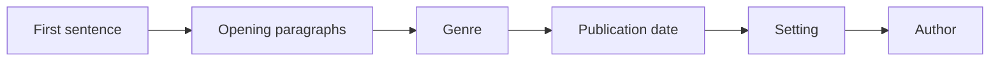
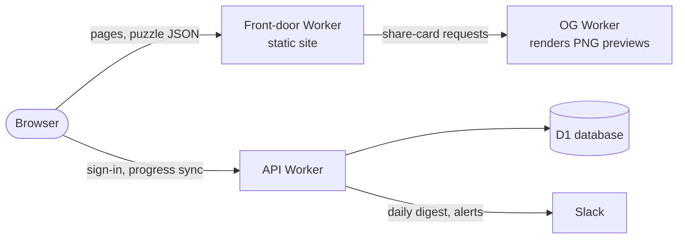
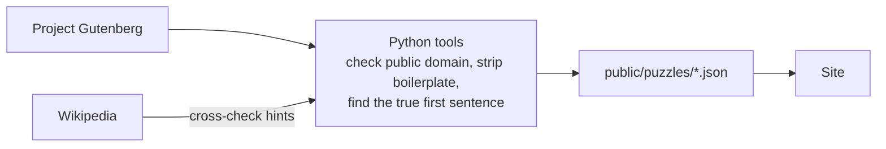

# Excerptle

**[excerptle.io](https://excerptle.io)**: name the book from its first sentence.

## What it does

Each day everyone gets the same public-domain book. You see its first sentence and have
**6 guesses** to name it. If you're stuck, take a hint. Each hint reveals more:



There are 720 books in all: a daily that resets at midnight Pacific, plus a bank of 600
you can play any time. When a round ends you can read the opening chapter.

## How it works



- **The game runs entirely in the browser** against pre-built JSON, so it still works
  if the API is down. The API only handles accounts and syncing progress between devices.
- **Stack:** TypeScript with no framework, bundled by esbuild. Cloudflare Workers and D1
  host it. Tests use Playwright and Node's built-in test runner.
- **Fuzzy title matching** ([`src/match.ts`](src/match.ts)): ignores case, punctuation
  and "The", accepts aliases like *Huck Finn*, and allows more typos in longer titles.
- **Share previews:** a shared link unfurls to a card for that puzzle. The heavy
  renderer (3.5 MB of WASM and fonts) lives in its own Worker, so the main site stays
  fast to load.

### Content pipeline



## Run it

```sh
npm ci
npm run build                                   # src/*.ts → public/js/
python3 -m http.server 8765 --directory public  # http://localhost:8765
```

`npm test` runs the type check and unit tests, `npm run test:e2e` the Playwright suite,
and `npm run test:data` checks all 720 puzzles. CI runs every suite on each push.

## Layout

```
public/    the website as deployed: HTML, CSS, assets, puzzles/
src/       browser TypeScript (game, auth, title matcher)
backend/   API Worker and D1 migrations
tools/     content pipeline, share-card Worker, unit tests
tests/     Playwright end-to-end tests
docs/      deployment and monitoring notes
```

Excerpts come from [Project Gutenberg](https://www.gutenberg.org/). This project is not
affiliated with it.
